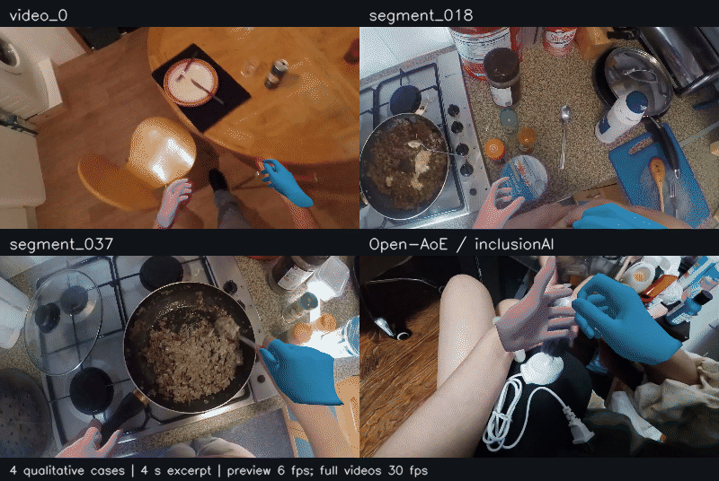

# HaWoR 复现：Conda 环境与服务器离屏渲染

基于 [ThunderVVV/HaWoR](https://github.com/ThunderVVV/HaWoR) 的复现 fork。HaWoR 从第一视角视频重建世界坐标系中的手部运动，原论文为 **HaWoR: World-Space Hand Motion Reconstruction from Egocentric Videos**（CVPR 2025 Highlight）。

本仓库补充固定版本的 Conda/Python 环境、Linux EGL 离屏渲染及复现文档。模型和推理算法沿用上游；这不是作者的官方发布仓库。上游基线：[`66c7d410`](https://github.com/ThunderVVV/HaWoR/tree/66c7d4108d58a716deccd192cb7645170cdc7bd7)。

[论文](https://arxiv.org/abs/2501.02973) · [项目主页](https://hawor-project.github.io/) · [上游原始说明](docs/UPSTREAM.md)


## 复现内容

- 固定 Python、PyTorch、CUDA 及关键依赖版本，保留完整环境快照。
- `demo.py --headless` 支持通过 SSH 导出 world / cam 两种 MP4，无需桌面窗口。
- 分开保存两种视角的结果，支持覆盖导出并释放离屏渲染资源。
- 提供不依赖 MANO 和权重的渲染检查，以及公开权重校验值。

已在 **Ubuntu 22.04 / NVIDIA A800 80 GB / Python 3.10 / PyTorch 1.13.0+cu117 / CUDA 11.7** 上跑通官方 `example/video_0.mp4`。其他系统、显卡与版本组合需要另行验证。

## 复现结果

已完成3段仓库示例和1段Open-AoE外部视频的推理，提供三视角对比、手部局部视频、关键帧、网格三视图和诊断统计。外部输入也存在手掌偏大、指尖贴合不足；这些结果属于定性复现，没有真值精度评测。



[完整复现报告](docs/RESULTS.md) · [完整视频与离线交互报告](https://github.com/ZSHYC/HaWoR/releases/tag/reproduction-2026-10-15) · [实验记录JSON](assets/results/experiments.json)

## 开始使用

```bash
git clone --recursive https://github.com/ZSHYC/HaWoR.git
cd HaWoR
```

1. 按 [安装指南](docs/INSTALL.md) 创建 Conda 环境、安装依赖并编译 CUDA 扩展。
2. 按 [模型准备](docs/MODELS.md) 下载公开权重，自行取得并放置 MANO 模型。
3. 激活环境，在仓库根目录运行示例：

```bash
conda activate hawor

# 按可用资源选择 GPU 编号。
CUDA_VISIBLE_DEVICES=0 python demo.py \
  --video_path ./example/video_0.mp4 --vis_mode world --headless

CUDA_VISIBLE_DEVICES=0 python demo.py \
  --video_path ./example/video_0.mp4 --vis_mode cam --headless
```

该示例的导出路径为：

```text
example/video_0/vis_world_0_120/aitviewer/video.mp4
example/video_0/vis_cam_0_120/aitviewer/video.mp4
```

未指定 `--headless` 时保留上游交互式窗口。输入视频旁的同名目录保存抽帧、跟踪、SLAM 与推理缓存；重复运行会复用缓存。替换视频内容或模型后，需要使用新视频路径或先备份并移走旧缓存。

## 验证与文档

| 文档 / 命令 | 用途 |
| --- | --- |
| [安装指南](docs/INSTALL.md) | Conda、CUDA 扩展、EGL 与常见环境问题 |
| [模型准备](docs/MODELS.md) | 下载来源、目录结构、SHA-256 与 MANO |
| [验证记录](docs/VALIDATION.md) | 已测试的范围、结果及已知限制 |
| [上游说明](docs/UPSTREAM.md) | 原始项目介绍、HOT3D / DexYCB 评测入口 |
| `python scripts/server/check_conda.py` | 检查真实 Conda 激活、退出、切换和变量恢复 |
| `python scripts/server/check_headless.py` | 无需 MANO / 权重，检查 world 与 cam 视频实际渲染和解码 |

## 仓库结构

```text
demo.py                    官方视频推理入口，新增 --headless
environment.yml            Conda 环境定义
requirements.txt           固定关键 Python 依赖
environment/               Conda 激活钩子与完整版本快照
docs/                      安装、模型和验证文档
scripts/server/            Conda 生命周期与离屏渲染检查
lib/、hawor/、infiller/     上游模型、推理、运动补全和渲染代码
thirdparty/                DROID-SLAM、Metric3D 及其依赖
hot3d/、scripts/scripts_eval/  上游数据处理与评测代码
example/                   上游示例视频
```

权重、MANO、数据集、环境、缓存和生成视频不纳入 Git。完整训练和数据集评测未在本次复现中验证；相关上游代码与说明仍予保留。

## 来源、许可与引用

原作者：Jinglei Zhang、Jiankang Deng、Chao Ma、Rolandos Alexandros Potamias。上游及第三方版权、署名和许可均保留。本 fork 的改动为环境配置、文档及离屏导出适配。

上游声明 HaWoR 模型使用 [CC BY-NC-ND 4.0](license.txt)；MANO 须单独遵守 [MANO 许可](https://mano.is.tue.mpg.de/license.html)。模型文件不随本仓库分发。第三方组件适用各自目录内的许可。

感谢上游及其使用的 [HaMeR](https://github.com/geopavlakos/hamer/)、[WiLoR](https://github.com/rolpotamias/WiLoR)、[SLAHMR](https://github.com/vye16/slahmr)、[TRAM](https://github.com/yufu-wang/tram)、[CMIB](https://github.com/jihoonerd/Conditional-Motion-In-Betweening)。

```bibtex
@article{zhang2025hawor,
  title={HaWoR: World-Space Hand Motion Reconstruction from Egocentric Videos},
  author={Zhang, Jinglei and Deng, Jiankang and Ma, Chao and Potamias, Rolandos Alexandros},
  journal={arXiv preprint arXiv:2501.02973},
  year={2025}
}
```
